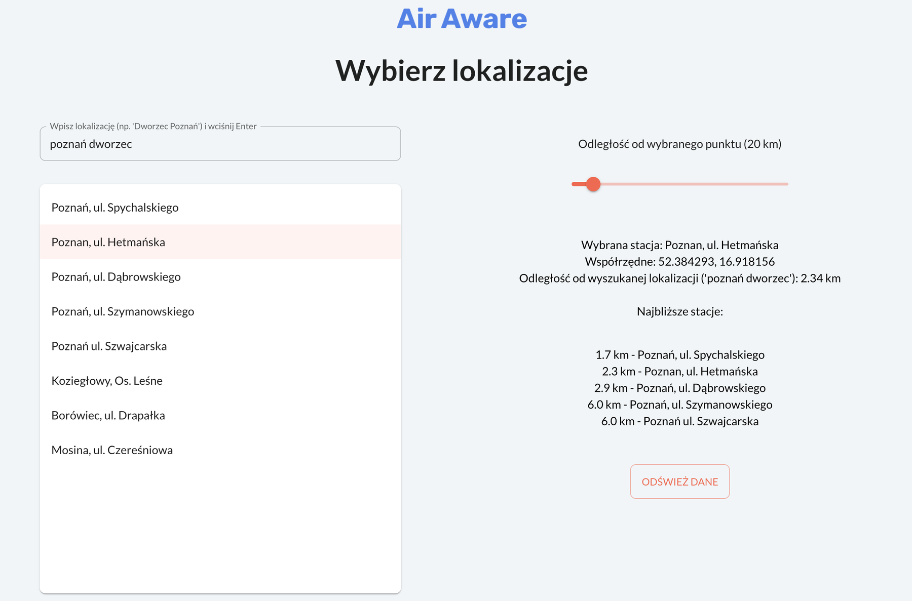
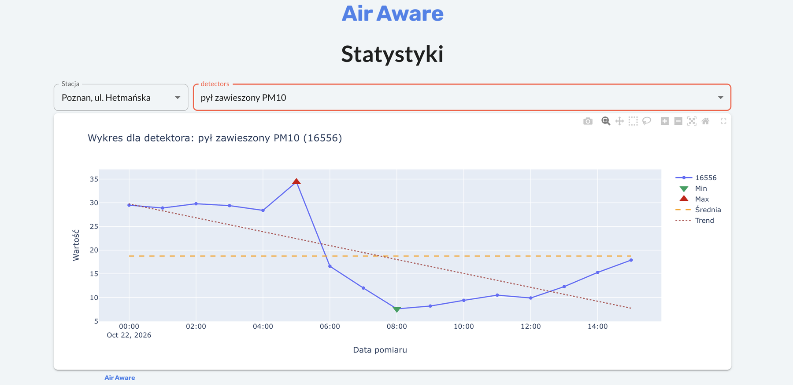
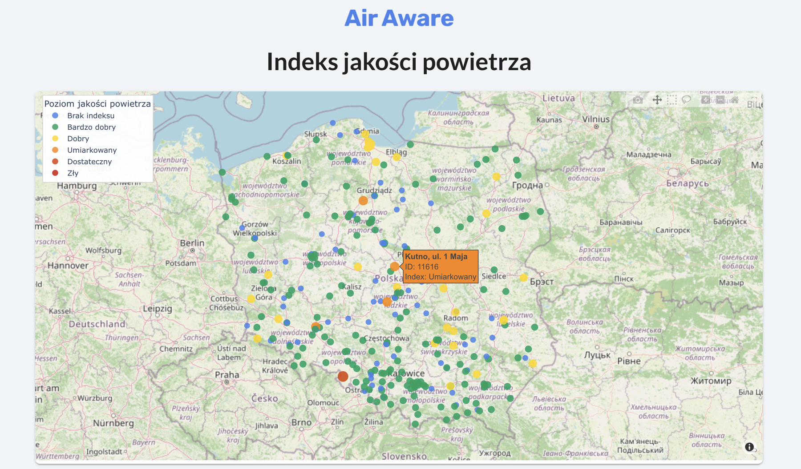

# 🌬 AirAware

**Air-quality monitoring for Poland, built on live data from the Chief Inspectorate of Environmental Protection (GIOŚ).**

AirAware fetches real-time measurements from the public GIOŚ REST API, stores them locally and turns them into interactive charts, maps and simple statistics. It also works offline: when the API is unreachable, it falls back to the data saved in its local database.



---

## ✨ Features

- **Live data** from the GIOŚ REST API: stations, sensors, measurements and the air-quality index.
- **Find stations near you:** type a place (e.g. *"Poznań dworzec"*) and a radius in km. The app geocodes it and lists stations within that distance (geopy).
- **Statistics page:** pick a station and a sensor to see the measurement history as an interactive chart, with min, max, average and trend.
- **Map page:** air-quality index of every station on an interactive map, coloured by category.
- **Offline mode:** measurements are stored in SQLite. Without a connection the app shows the stored history, and the station search tells the user there is no internet connection.
- **Clean structure:** API client, data models with converters, storage layer, analysis and GUI kept in separate modules. Shared data is managed by a `DataStore` singleton.
- **Tested and documented:** 33 unit tests (pytest, API calls mocked) and Sphinx documentation generated from docstrings.

| Statistics | Map |
|---|---|
|  |  |

---

## 🧱 Tech stack

| Area | Tools |
|---|---|
| Language | Python 3.12 |
| GUI | Taipy 4 |
| Data | pandas, SQLite |
| Charts & maps | Plotly |
| Geolocation | geopy (Nominatim) |
| HTTP | requests |
| Tests | pytest, unittest.mock |
| Docs | Sphinx |

---

## 🗂 Project structure

```
AirAware/
├── main.py                 # entry point: starts the Taipy app
├── chart.py                # Plotly map of the air-quality index
├── gui/                    # Taipy pages and callbacks
├── air_monitor/
│   ├── api_client/         # GIOŚ REST API calls
│   ├── models/             # stations, sensors, measurements, AQ index (+ converters)
│   ├── database/           # SQLite storage and data handling
│   ├── utils/              # DataStore singleton, nearest stations, analysis logic
│   └── tests/              # unit tests
├── docs/                   # Sphinx documentation
└── assets/                 # icons and screenshots
```

---

## 🚀 Getting started

```bash
git clone https://github.com/marcela-os/AirAware.git
cd AirAware
python -m venv .venv
source .venv/bin/activate        # Windows: .venv\Scripts\activate
pip install -r requirements.txt
python main.py
```

The app opens in your browser. Taipy serves it locally and prints the address in the terminal.

### Run the tests

```bash
python -m pytest air_monitor/tests -v
```

### Build the documentation

```bash
cd docs
make html                         # Windows: make.bat html
open _build/html/index.html       # Windows: start _build\html\index.html
```

---

## 🗺 Roadmap

- [ ] **PM2.5 forecast for the next 24 h:** baseline ("tomorrow like today") compared with linear regression, random forest and gradient boosting (scikit-learn), time-based validation, MAE and error analysis, feature importance shown in the dashboard
- [ ] Forecast served as an API (FastAPI)
- [ ] Docker image for one-command setup
- [ ] Online demo
- [ ] English version of the interface

---

## 📄 Data source

Air-quality data: [GIOŚ – Główny Inspektorat Ochrony Środowiska](https://powietrze.gios.gov.pl/pjp/content/api), public API.

## 👩‍💻 Author

**Marcelina Migdalski**: [GitHub](https://github.com/marcela-os) · [LinkedIn](https://www.linkedin.com/in/marcelinamigdalski)
